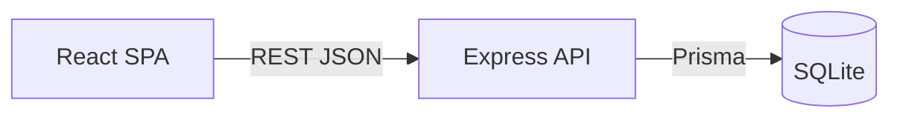

# ACME Payroll Management — Architecture

**Stack:** React + TypeScript + Vite · Node.js + Express + TypeScript · SQLite · Prisma

## 1. Architecture Overview

A three-tier web app. The HR Manager uses a Vite-built React SPA that calls a stateless Express API. Prisma is the only data-access layer; SQLite stores employees, salaries, and revision history. Authentication is deferred; routes can accept auth middleware later without domain changes.



## 2. Responsibilities

**Frontend.** Dashboard, employee list, profiles, salary history, filters, and CSV download. Holds search, sort, page, and filter state. Requests the current page and KPI payloads only.

**Backend.** REST resources, input validation, business rules (required fields, salary amounts, ISO currency codes), pagination, and compensation aggregates. Maps Prisma models to JSON and a consistent error shape.

**Database.** Employee profiles, current salary (amount plus ISO currency), and revision history. Prisma migrations own the schema. Indexes cover filter, search, and sort columns.

## 3. Frontend–Backend Communication

The SPA calls JSON endpoints under `/api`: `/api/employees`, `/api/employees/:id`, `/api/employees/:id/salaries`, `/api/analytics`, and `/api/export`. List calls pass search, country, department, designation, sort, page, and page size. Lists return `{ data, meta }`; a single record returns the resource. CSV export reuses the same filters and returns `text/csv`. One client API module owns the base URL and error parsing.

## 4. Suggested Backend Structure

```
server/
  src/
    index.ts        # bootstrap
    app.ts          # Express and middleware
    routes/
    controllers/
    services/
    validators/
    middleware/
  prisma/
    schema.prisma
    migrations/
```

## 5. Error Handling and Validation

Validate writes and query params with a schema library (Zod) before services. Invalid amounts or ISO currency codes return **400** with field errors. Missing employees return **404**; unique conflicts return **409**. Central error middleware maps unexpected failures to **500** without stack traces. The UI shows field errors on forms and a short message when lists or analytics fail.

## 6. Performance (10,000+ Employees)

Paginate in SQL and return totals separately. Index country, department, designation, and common sort columns. Compute analytics with grouped queries. Stream CSV instead of buffering the full file. Enable SQLite WAL mode. Load salary history only on the profile route to avoid N+1 reads.

## 7. Testing Strategy

- **Unit:** validators and salary-history rules, no database.
- **API:** Supertest against Express with a temporary SQLite file and Prisma migrations.
- **Data:** seed about 10,000 rows; assert list, filter, and analytics stay paginated and correct.
- **UI:** component tests for filters, forms, and empty or error states; one flow for create, salary update, and filter.

Currency conversion, payroll, tax, bank payouts, and role-based access stay outside this architecture until explicitly added.
